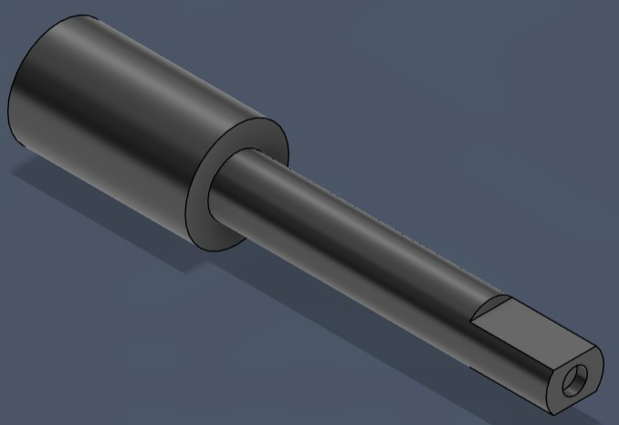
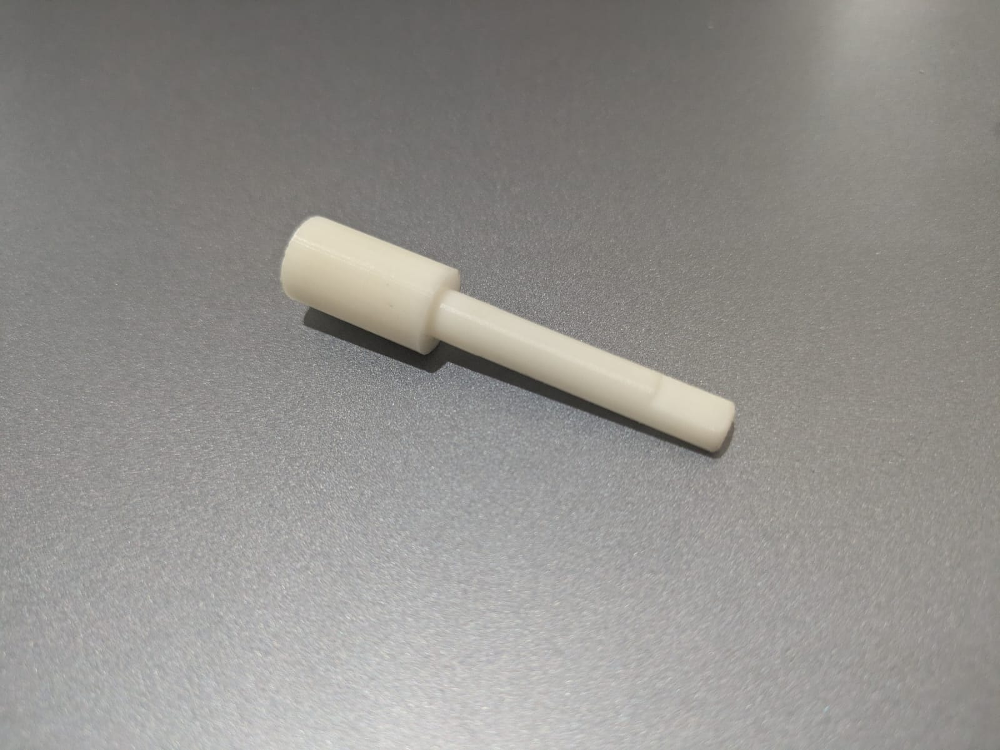
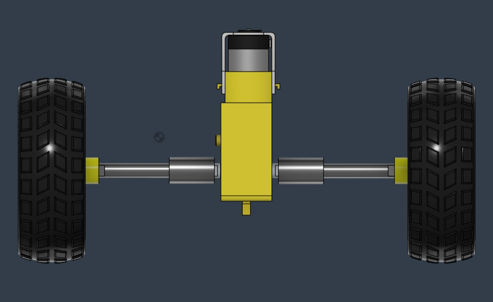
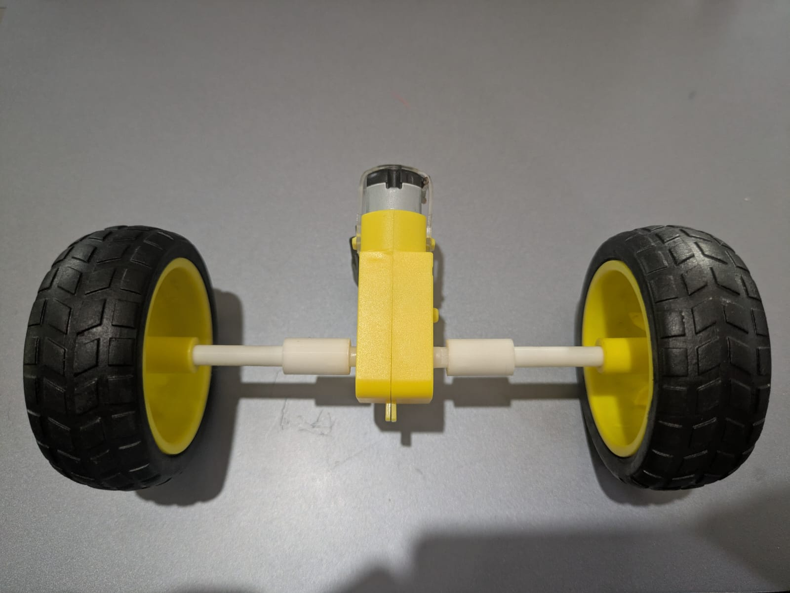
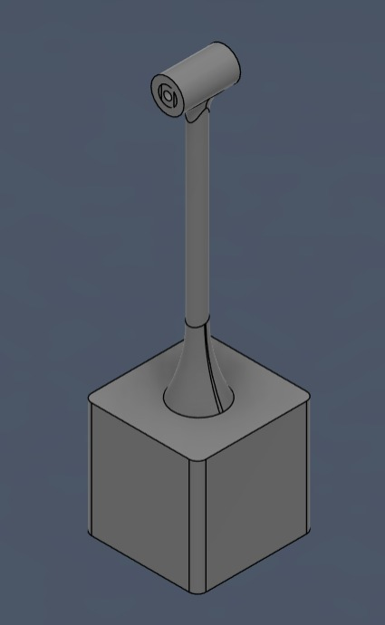
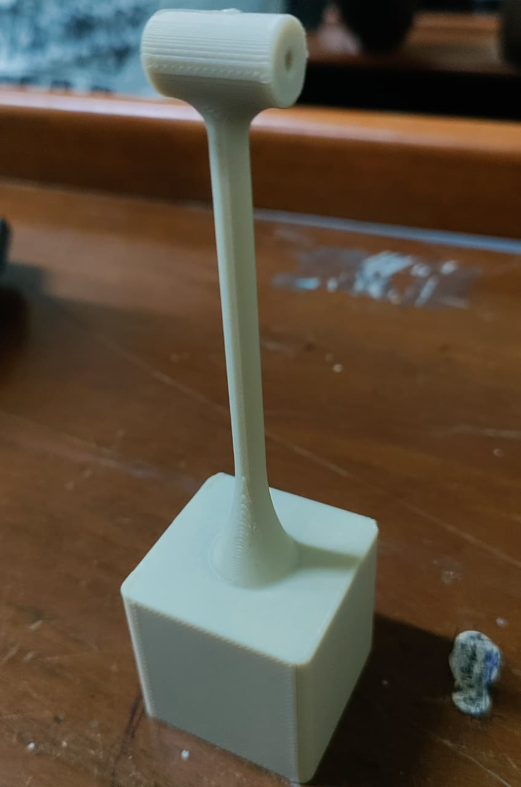
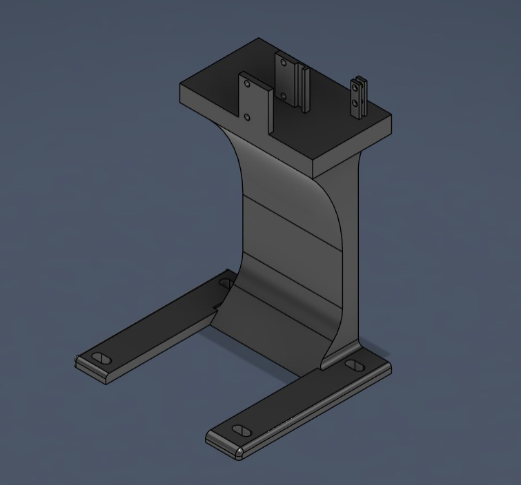
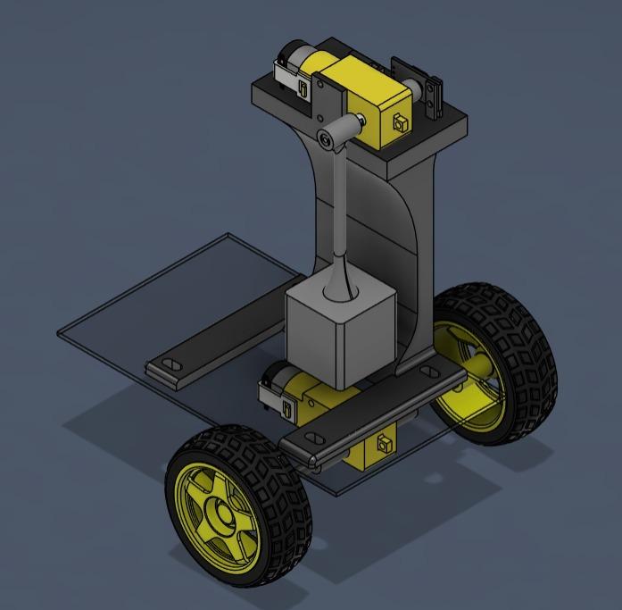
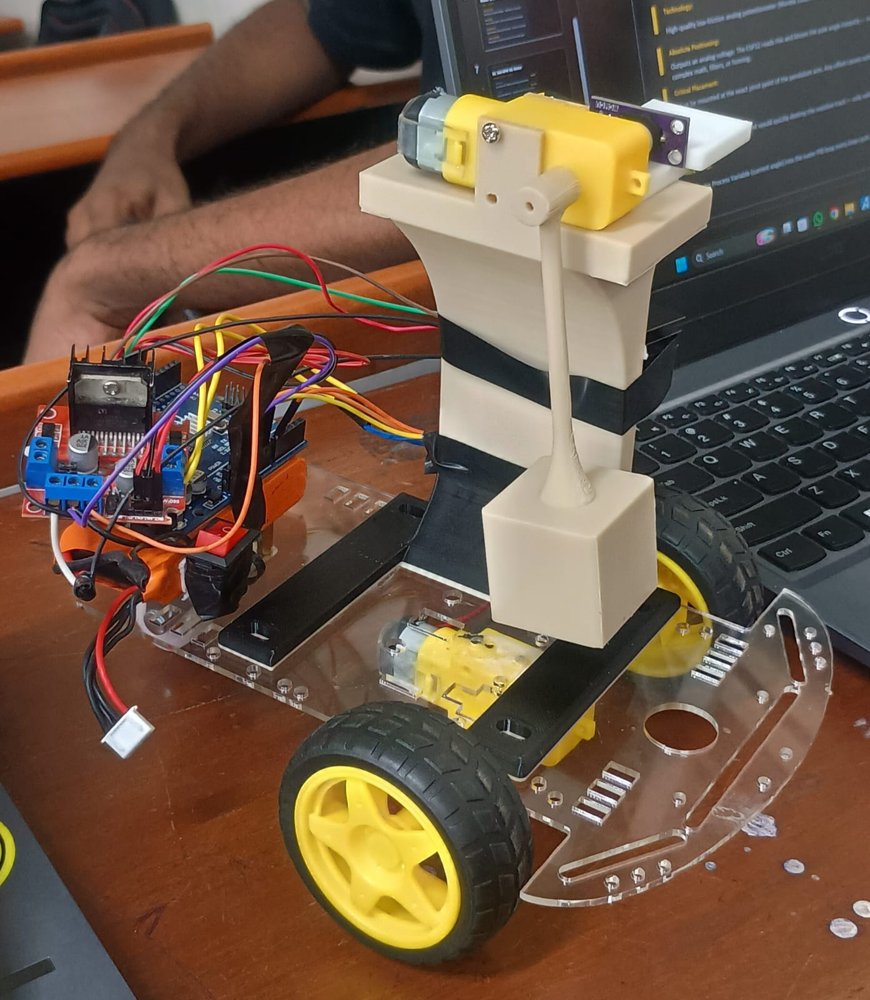

# Self-Balancing Inverted Pendulum while in Movement

ME2400 — Class Project

Manoj · Nishanth · Sai Praneeth · Balaji · Jayvardhan · Rahul

## Project Aim

An inverted pendulum balanced upright on a moving two-wheeled chassis — inherently unstable without continuous correction.

PID closed-loop feedback continuously reads the tilt angle and drives the motors to keep the pendulum upright while navigating.

Integrates DC motor control, angle sensing, microcontroller logic, and custom CAD chassis — demonstrating P&ID mechatronics principles.

## Demo

[Watch the demo video](https://drive.google.com/file/d/1lj9NfjpqzahR9fvkhXKLoS323zjULQnU/view?usp=sharing)

[Video file in this repo](video/demo.mp4)

## What is a PID System?

In mechatronics, PID is the most used form of closed-loop feedback control. It continuously calculates an error value — the difference between a desired setpoint and the measured process variable — and automatically applies corrections.

`Error = Setpoint − Process Variable`

| Term | | |
|---|---|---|
| **P** Proportional | The Present | Applies a correction force proportional to the current error. Larger tilt = larger motor response. |
| **I** Integral | The Past | Accumulates past errors to eliminate steady-state offset. Corrects for persistent small biases. |
| **D** Derivative | The Future | Predicts future error from the rate of change. Acts as a damper to prevent oscillation. |

Tuning responses covered in the presentation: overdamped, underdamped and critically damped. Things that can go wrong: Kd too small, Kd too big.

Ideal response: the response curve quickly approaches the setpoint with no overshoot and settles with little to no oscillation.

## Hardware

| # | Component | Role |
|---|---|---|
| 01 | Arduino UNO / ESP32 | Microcontroller — Brain |
| 02 | Motor Driver HW-095 | H-Bridge — Muscle |
| 03 | DC 300 RPM BO Motor (Dual Shaft) | Actuation — Movement |
| 04 | CJMCU-103 Rotary Angle Sensor | Sensing — Tilt Feedback |
| 05 | Custom CAD Chassis | Structure — Assembly |

**Arduino UNO** — Sense: reads the tilt angle every millisecond from the angle sensor. Think: runs the PID algorithm to compute the required motor correction. Act: sends PWM signals to the motor driver to adjust wheel speed and direction.

**Motor Driver HW-095** — Plugs directly into the Arduino UNO/Mega, eliminating dozens of jumper wires. Dual H-bridge: uses four transistor switches to drive two motors independently in both directions. Handles both speed control and directional control. Works well with 7.4–9V power sources common to this class of robotics project.

**DC 300 RPM BO Motor** — 300 RPM is fast enough to catch a falling robot, slow enough to maintain resolution. Gear ratio 1:48 / 1:120: high gearing multiplies torque and can support the weight of the chassis and battery. Gear backlash introduces dead-zone errors the PID must compensate for. Driver pairing: HW-130 (L298N).

**CJMCU-103 Rotary Angle Sensor** — High-quality low-friction analog potentiometer (Murata 10kΩ rotary). It outputs an analog voltage, so the pole angle is known instantly with no complex math, filters, or homing. It must be mounted at the exact pivot point of the pendulum arm, since any offset causes systematic error. Continuous rotation at 300 RPM would quickly destroy the resistive track, so it is only valid for slow angular oscillation. It feeds the process variable (current angle) into the PID loop every loop cycle.

## Design

Custom 3D printed parts: chassis designed and modelled in CAD — shaft component, final drive assembly, custom pendulum platform, final assembly.

| | CAD Model | Photo |
|---|---|---|
| **Shaft Component** |  |  |
| **Final Drive Assembly** |  |  |
| **Pendulum** |  |  |
| **Custom Pendulum Platform** |  | |
| **Final Assembly** |  |  |

## Code

`self_balancing_pendulum/self_balancing_pendulum.ino`

**Pins**

| | Enable | Input 1 | Input 2 |
|---|---|---|---|
| Pendulum motor (Motor B) | ENB = 9 | IN3 = 7 | IN4 = 8 |
| Cart motor (Motor A) | ENA = 12 | IN1 = 10 | IN2 = 11 |

Rotary sensor on `A0`.

**Settings**

| Setting | Value |
|---|---|
| `Kp` / `Kd` / `Ki` | 18.0 / 1.4 / 0.6 |
| `SWING_PWM` | 170 |
| `CATCH_ZONE` | 45° (0° is the top) |
| `WIGGLE_DURATION` | 2000 ms |
| `MOVE_DURATION` | 2000 ms per direction |
| `cartSpeeds[]` | 100, 130, 150, 180, 220 |

**How it runs**

1. On power-up the pendulum must be at the very bottom. It is calibrated so that the bottom position is 180°.
2. The cart starts moving first, forward then backward, 2 seconds each. After every forward and backward trip it moves to the next speed in `cartSpeeds[]`.
3. The pendulum first oscillates to and fro for 2 seconds.
4. After that, swing-up pushes the pendulum toward the top. Once the angle is within ±45°, PID takes over, while the cart keeps moving.

**Notes**

- Motor moving the wrong way: swap the two wires in the blue terminal block on the HW-095.
- Stuck at bottom: increase `SWING_PWM` to 180.
- Overshooting the top: decrease `SWING_PWM` or increase `Kd`.
- Make sure the power supply can handle both motors running at once.
- Turn off the external battery power to the HW-095 before uploading, then turn it back on once the upload is done.
